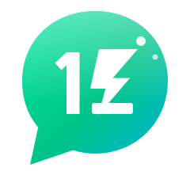

<p align="center">
  
</p>

# OneZchat 💚 — Chat Freely. Chat Securely.

A WhatsApp-style browser chat with a luxury obsidian-and-champagne UI, cinematic intro animations,
groups, voice & video
calls — and **true end-to-end encryption**. No phone number, no e-mail, **no password**:
type your name and you instantly get your own **OneZ ID** (e.g. `OZ-7K3F9X`) which is
generated and saved on your device. Next time you open it, you're straight in.

```
  💚 OneZchat — name dunnahama ID eka hadenawa, device eke save wenawa,
     aya log weddi ekenma yanna puluwan. Password naa!
```

## ✨ Features

| | |
|---|---|
| 🔐 **No-password identity** | Name → OneZ ID + secret device token + encryption keys, saved in your browser |
| 🔒 **End-to-end encryption** | ECDH P-256 + AES-256-GCM (WebCrypto). Server stores **ciphertext only** |
| 💬 **1-to-1 chats** | Real-time WebSocket messaging |
| 👥 **Groups** | Create groups, add members — group key wrapped per-member, E2E like WhatsApp |
| 🟢 **Status / Stories** | Post text (10 gradient backgrounds) or photo statuses, auto-expire after 24h, see who viewed them, reply straight into a DM — encrypted with a per-viewer wrapped key |
| ✔✔ **Ticks** | Sent ✓ · Delivered ✓✓ · Read ✓✓ (blue) |
| 🟢 **Presence** | Online / last seen / *typing…* indicators |
| 📷 **Photos** | Send images (auto-compressed, encrypted), drag-&-drop / paste supported |
| 🎤 **Voice messages** | Record & send, WhatsApp-style |
| 🎭 **Stickers** | 5 sticker packs (Mood, Love, Fun, SL 🇱🇰, Reacts) sent as borderless big-emoji messages |
| 📞 **Voice & video calls** | WebRTC peer-to-peer (DTLS-SRTP encrypted) |
| 👥 **Group calls** | Mesh WebRTC calls for up to 9 people with a video grid, live participant chips and a speaking highlight |
| ❤️ **Reactions & replies** | React, quote-reply, copy, delete-for-everyone |
| 🤖 **OneZ Bot** | Built-in assistant — chat with it, ask for `help` or a `joke`; it posts a Status too |
| 🎨 **Luxury UI** | Obsidian & champagne design system, couture splash reveal (hairline frame, serif wordmark, gold shimmer), jewel-toned bubbles, glass panels, dark/light themes, mobile-first |

## 🚀 Run it

```bash
npm install
npm start
# open http://localhost:3000
```

Requires Node.js ≥ 18. Data is stored in `data/db.json` (created automatically).

> **Note:** WebCrypto (used for E2E encryption) needs a *secure context* — `https://`
> or `http://localhost`. If you deploy it, put it behind HTTPS (or a reverse proxy).

**Try it with two people:** open the app in two different browsers (or one normal +
one incognito window), register two names, then find each other in the **People** tab —
or search by OneZ ID.

## 🛡️ Security design

- **End-to-end encryption** — every message (text, photo, voice, sticker) *and every
  Status* is encrypted *in the browser* before it is sent. The server cannot read them;
  it only relays ciphertext.
- **Keys never leave the device** — each device generates an ECDH P-256 key pair.
  Only the public key is published; the private key stays in that browser's local storage.
- **Group & Status keys** — a random AES-256 key is generated by the creator and encrypted
  ("wrapped") individually for each member/viewer using ECDH — the same idea WhatsApp uses.
  A Status can only be opened by the people it was wrapped for.
- **Calls** — 1-to-1 *and* group calls are peer-to-peer WebRTC; media is encrypted by the
  browser (DTLS-SRTP) and the server only relays opaque signaling to chat members
  (non-members are rejected).
- **Device token** — login uses a 256-bit random token saved on the device. The server
  keeps only its **SHA-256 hash** (compared in constant time), so a database leak
  doesn't reveal usable credentials.
- **Hardened server** — strict input validation & size limits, per-IP registration
  rate-limiting, per-socket flood limits, CSP + security headers, atomic file writes.
- **Calls** — WebRTC media is encrypted end-to-end by the browser (DTLS-SRTP);
  the server only passes signaling messages between chat members.

> No real-world system can honestly promise "100% unhackable" — but OneZchat follows the
> same security architecture (E2E encryption, hashed credentials, least-privilege server)
> that modern messengers use. Because your identity *is* your device key, **logging out
> erases the OneZ ID on that device permanently** — there is no password reset by design.

## 🗂️ Project structure

```
server.js            Node HTTP + WebSocket server, JSON DB, stories, OneZ Bot
public/
  index.html         App shell (splash, onboarding, chats, status, calls)
  style.css          Luxury design system: tokens, themes, animations, bubbles, story viewer
  crypto.js          WebCrypto E2E engine (ECDH + AES-GCM, key wrapping)
  app.js             Client logic: identity, chats, groups, status, stickers, mesh calls
  logo.svg           Luxury emblem (obsidian tile, champagne hairlines, emerald jewel bubble)
  icon.svg           Maskable app icon source
  icons/             Generated PWA icons (192/512, any + maskable)
data/                (git-ignored) runtime database
```

Made with 💚 in Sri Lanka 🇱🇰
